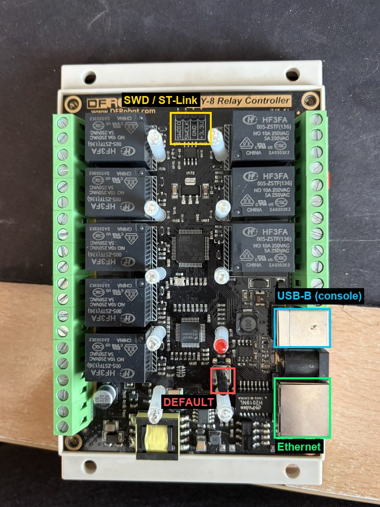
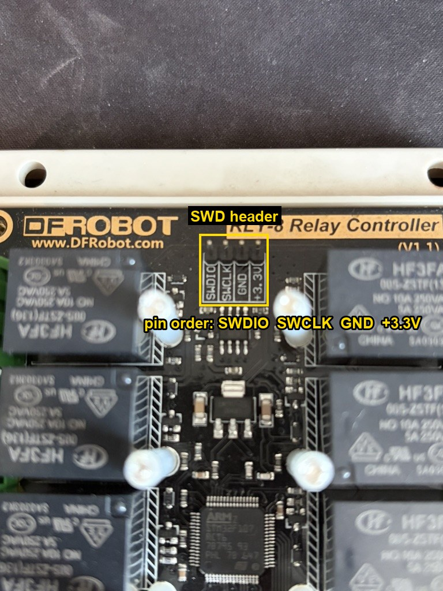

# DFR0289 RLY-8 open firmware

Replacement firmware for the **DFRobot RLY-8 (DFR0289) 8-channel relay controller**
(STM32F107 + DP83848 Ethernet, PoE / USB). It turns the board into a **Home Assistant
friendly MQTT device** with a built-in **web panel**, a **USB serial console** and a
**factory-reset button**. You can still switch relays without Home Assistant, from the
panel, the console or plain MQTT.

> **Polski:** pełna instrukcja po polsku jest [niżej](#polski).

> **Not affiliated with DFRobot.** "DFRobot" and "RLY-8" are used only to say which
> hardware this runs on. Flashing this firmware **replaces the stock firmware**. This
> project does not distribute the original firmware, so back it up first if you may want it
> back (see [Backup](#1-back-up-the-stock-firmware-optional-but-recommended)).
>
> **Relays may switch mains voltage.** Work on the board only when it is disconnected from
> mains. Use at your own risk.



## Why

The stock firmware only speaks DFRobot's own JSON-over-TCP and `55 AA` binary protocols.
It has no Home Assistant integration and no MQTT. This firmware speaks MQTT with Home
Assistant discovery out of the box. It is configured from a browser or over USB. It finds the
Home Assistant broker on its own.

## Features

| | |
| --- | --- |
| **Home Assistant** | MQTT discovery: 8 `switch` entities appear automatically, with availability (online/offline) and a link to the web panel on the device page |
| **Broker autodetection** | empty broker field → mDNS `_mqtt._tcp.local`, then `homeassistant.local`; or set an IP / DNS name / `*.local` name |
| **MQTT** | 3.1.1, username/password, retained state, last-will availability, reconnect with back-off |
| **Web panel** | status, 8 relay buttons, network (DHCP/static), MQTT, device name, admin password, factory reset, JSON status API; HTTP Basic auth + per-boot CSRF token |
| **USB console** | USB-B port enumerates as a CDC serial port: `status`, `show`, `set`, `save`, `relay`, `reboot`, `factory` |
| **mDNS** | reachable as `http://rly8-xxxxxx.local/` (last 3 MAC bytes) |
| **DEFAULT button** | hold 5 s → factory defaults (DHCP, password `admin`, MQTT autodetect) |
| **Blue status LED** | shows link / IP / MQTT state (it does nothing on the stock firmware) |
| **Persistent config** | two flash pages (A/B copies with CRC32), so a power cut while saving cannot brick the settings |
| **Firmware update from the browser** | upload `*-update.bin` in the panel; a small bootloader verifies (CRC32 + image header) and installs it, power-cut safe; settings are kept |
| **Safe boot** | all relays OFF at power-up, no click sequence |

## Hardware notes (measured on a real board)

| Item | Value |
| --- | --- |
| MCU | STM32F107RCT6 (Cortex-M3, 256 KB flash, 64 KB RAM) |
| Clock | HSE **25 MHz** oscillator → 72 MHz via PLL2 |
| Ethernet PHY | TI DP83848, MDIO address 1, **MII**; the PHY has no crystal: its clock comes from the MCU's **MCO pin (PA8)** |
| Relays 1–8 | PC8, PC9, PC10, PC11, PC12, PC7, PC6, PB15 (active high) |
| Blue LED | PB7 (active low) |
| DEFAULT button | PB14 (pressed = low) |
| USB-B | native OTG FS (PA11/PA12). PA9 sees no VBUS on this board, so the firmware forces it high |
| Debug | 4-pin SWD header: **SWDIO, SWCLK, GND, +3.3V** |

More detail: [docs/hardware-findings.md](docs/hardware-findings.md),
[docs/relay-mapping.md](docs/relay-mapping.md).

## Installing

### What you need

- an **ST-Link** (V2 clone is fine) or any other SWD probe, 4 jumper wires
- [pyOCD](https://pyocd.io) (`pip install pyocd`). OpenOCD or STM32CubeProgrammer also work
  with any SWD probe, but we only tested pyOCD with an ST-Link
- the release file **`rly8-fw-vX.Y.Z-full.bin`** (or `-full.hex`) from
  [Releases](https://github.com/lsochanowski/DFR0289-RLY-8-Firmware/releases): bootloader
  plus application. The SWD probe is needed only once. Later updates go through the web panel.

### Wiring



| Board header | ST-Link |
| --- | --- |
| SWDIO | SWDIO |
| SWCLK | SWCLK |
| GND | GND |
| +3.3V | 3.3V (optional if the board is powered by PoE/DC; then connect only GND + signals) |

Power the board normally (PoE or DC). Do not feed 3.3 V from the probe and from the board
regulator at the same time unless your probe is designed for it.

### 1. Back up the stock firmware (optional but recommended)

```bash
pyocd cmd -t stm32f103rc -c "savemem 0x08000000 0x40000 rly8-stock.bin"
```

If the read returns errors or only zeros, the chip may have read-out protection. Then the
stock firmware cannot be saved, and flashing needs a mass erase first (`pyocd erase --chip`).

### 2. Flash

```bash
pyocd flash -t stm32f103rc rly8-fw-v2.1.0-full.bin --base-address 0x08000000
pyocd reset -t stm32f103rc
```

`-t stm32f103rc` is intentional: pyOCD has no built-in STM32F107 target, and the flash
algorithm of the F1 family is the same for this 256 KB part. With more than one probe
connected, add `-u <probe UID>` (list them with `pyocd list`). With the `.hex` file,
`--base-address` is not needed.

### 3. First boot

1. Plug in Ethernet. The board asks for an address over DHCP.
2. Open `http://rly8-xxxxxx.local/`, or look up the address in your router. You can also
   type `status` in the USB console.
3. Log in as **admin / admin** and **change the password** under *Settings*.

If no DHCP server answers within 15 s, the board uses the fallback address
**192.168.9.50/24**. You can change it in the panel.

## Using it

### Web panel

The web panel has two pages:

- **Status**: link, IP, MQTT state and broker, 8 relay toggles, all-on/all-off, restart
- **Settings**: DHCP or static IP, host name, MQTT on/off, broker (empty =
  autodetect), port, user, password, discovery prefix, device name, admin password,
  factory reset
- `GET /api/status`: JSON `{"node","name","fw","ip","link","uptime","mqtt","relays":[…]}`

Saving settings writes flash and reboots the device.

### Updating the firmware (v2.0.0 and later)

1. Download `rly8-fw-vX.Y.Z-update.bin` from Releases.
2. Open *Settings*, go to **Firmware update**, pick the file and press
   **Upload and restart**.
3. The upload takes about 3 s. The board then restarts. The bootloader installs the image
   while the blue LED is lit steadily for about 3 s. The panel is back after roughly 20 s.
   Settings are kept.

These checks run before anything is installed:

- the file must be an RLY-8 application image (header magic, link address, exact size).
  The `-full.bin`, a v1.x `.bin` and random files are refused, and the running firmware is
  not touched;
- the CRC-32 of what landed in flash must match what was sent;
- if the connection drops mid-upload, nothing changes;
- if power is lost **during the install**, the bootloader starts the copy again at the next
  power-up. This was tested by resetting the MCU halfway through the copy.

**Coming from v1.x?** v1 has no bootloader, so flash `-full.bin` over SWD once. Settings
are kept because the config pages stay in the same place.

Flash map:

| Address | Size | Content |
| --- | --- | --- |
| `0x08000000` | 8 KB | bootloader |
| `0x08002000` | 120 KB | application |
| `0x08020000` | 120 KB | staging slot for uploads |
| `0x0803E000` | 2 KB | update control record |
| `0x0803F000` | 4 KB | settings (two copies) |

### Home Assistant

1. In Home Assistant you need a broker, for example the **Mosquitto** add-on, and the
   **MQTT** integration.
2. In the board's panel, leave **Broker** empty (autodetect). Enter the **MQTT user and
   password**: the Mosquitto add-on rejects anonymous clients.
3. The device appears under *Settings → Devices → MQTT* with 8 switches.

Topics (`<node>` = host name, default `rly8-xxxxxx`):

| Topic | Direction | Payload |
| --- | --- | --- |
| `homeassistant/switch/<node>/relay<N>/config` | device → HA (retained) | discovery JSON |
| `<node>/relay<N>/set` | HA → device | `ON` / `OFF` |
| `<node>/relay<N>/state` | device → HA (retained) | `ON` / `OFF` |
| `<node>/status` | device → HA (retained, last will) | `online` / `offline` |

The `homeassistant` prefix can be changed in the settings.

### USB console

Connect the USB-B port to a computer. It shows up as a serial port: `/dev/cu.usbmodem*`
on macOS, `/dev/ttyACM*` on Linux, a COM port on Windows (VID:PID `0483:5740`). The baud
rate does not matter.

```bash
screen /dev/cu.usbmodem* 115200
```

```text
help                             list commands
status                           network, MQTT, relays
show                             configuration (passwords masked)
set <key> <value>                change a setting (pending until 'save')
save                             store settings (applied after reboot)
reboot
factory                          factory defaults + reboot
relay <1-8|all> <on|off|toggle>
```

Setting keys:

| Key | Meaning | Default |
| --- | --- | --- |
| `dhcp` | `on` / `off` | on |
| `ip`, `mask`, `gw`, `dns` | static address; also the fallback when DHCP fails | 192.168.9.50 / 255.255.255.0 / 192.168.9.1 / 192.168.9.1 |
| `hostname` | DHCP / mDNS name, empty = `rly8-xxxxxx` | empty |
| `name` | device name in Home Assistant | RLY-8 |
| `mqtt` | `on` / `off` | on |
| `mqtt_host` | IP, DNS name, `*.local`; empty = autodetect | empty |
| `mqtt_port` | | 1883 |
| `mqtt_user`, `mqtt_pass` | broker credentials | empty |
| `mqtt_prefix` | HA discovery prefix | homeassistant |
| `admin_pass` | web panel password (user `admin`) | admin |

### DEFAULT button and status LED

Hold **DEFAULT** for 5 seconds. The blue LED flickers fast while you hold it, then lights
steadily and the board restarts with factory settings: DHCP, password `admin`, MQTT
autodetect.

| Blue LED | Meaning |
| --- | --- |
| short flash every 2 s | no Ethernet link |
| blinking 2× per second | link, waiting for an IP address |
| double flash every second | has IP, MQTT not connected yet (or wrong credentials) |
| steady on, short blink on activity | everything up |
| steady ~3 s right after an update | bootloader is installing the new firmware |
| fast blinking (~8 Hz) forever, panel unreachable | bootloader found no valid application: reflash `-full.bin` over SWD |

## Building from source

Requirements: `arm-none-eabi-gcc` (tested with Arm GNU Toolchain 13.3), `make`, a host C
compiler for the unit tests.

```bash
cd firmware
make test       # host unit tests (protocol, MQTT, config, HTTP, panel, console, mDNS)
make app        # build/app.elf
make boot       # build/boot.elf (bootloader)
make full       # build/full.bin + full.hex (bootloader + application)
make release    # dist/: -full.bin/-full.hex (SWD), -update.bin (web panel), .elf, SHA256SUMS
make flash      # flashes full.hex with pyOCD; add STLINK_UID=<uid> to pick a probe
```

Layout:

```text
firmware/
  core/        portable logic, unit-tested on the host (MQTT, HA discovery, config,
               HTTP parser, web pages, console, mDNS, OTA/bootloader, stock protocol codecs)
  port/f107/   STM32F107 drivers: clock, GPIO/relays, Ethernet MAC+DMA, lwIP glue,
               HTTP server, mDNS, flash config, USB CDC, LED/button
  app/         startup + main loop
  boot/        bootloader (installs uploaded images; logic in core/rly_ota.c)
  third_party/ lwIP 2.2.0, ST CMSIS device header
docs/          hardware findings, relay mapping, stock protocol notes
```

## Security notes

- The panel uses **HTTP Basic auth without TLS**. Use it only on a trusted network, and
  change the default password.
- Passwords (panel, MQTT) are stored **unencrypted** in the MCU flash.
- The **USB console has no password**: anyone with physical access can change settings.
  They can also reset everything with the button anyway.
- State-changing requests are POST-only and carry a per-boot CSRF token. Firmware uploads
  need the admin password and that token as well.
- Firmware images are **not signed**: whoever knows the admin password can install any
  image that passes the format check.

## Limitations / roadmap

- Not implemented yet: the stock protocols (JSON on TCP port 2000, `55 AA` frames over RS485).
  Codecs exist in `core/` and are tested; they are not wired to TCP/RS485.
- Relay states are not restored after a power cut; all relays start OFF.

## License

MIT, see [LICENSE](LICENSE). Third-party components keep their own licenses: lwIP (BSD-3-Clause,
in each source file) and the ST CMSIS device header (Apache-2.0). See
[THIRD_PARTY.md](THIRD_PARTY.md).

---

## Polski

*English version: [top of this page](#dfr0289-rly-8-open-firmware).*

Firmware zastępczy dla 8-kanałowego sterownika przekaźników **DFRobot RLY-8 (DFR0289)**.
Po wgraniu płytka działa jako urządzenie **MQTT dla Home Assistanta**. Ma **panel WWW**,
**konsolę USB** i **przycisk przywracania ustawień fabrycznych**.

> Projekt nie jest związany z firmą DFRobot. Wgranie firmware **zastępuje oryginalny**.
> Jeśli chcesz mieć możliwość powrotu, zrób najpierw kopię (pkt 2.2).
> Przekaźniki mogą przełączać napięcie sieciowe. Pracuj przy płytce odłączonej od sieci 230 V.


### 1. Co potrafi

- 8 przełączników w Home Assistant **bez konfiguracji ręcznej** (MQTT discovery)
- **autodetekcja brokera** w sieci (mDNS `_mqtt._tcp.local`, potem `homeassistant.local`)
- panel WWW: stan, przełączanie przekaźników, ustawienia sieci i MQTT, hasło, reset fabryczny
- konsola tekstowa po **USB** (gniazdo USB-B)
- nazwa w sieci lokalnej: `http://rly8-xxxxxx.local/`
- **przycisk DEFAULT** (5 s) przywraca ustawienia fabryczne
- **niebieska dioda** pokazuje stan urządzenia
- **aktualizacja firmware z przeglądarki** (od v2.0.0), ustawienia zostają zachowane
- po włączeniu zasilania wszystkie przekaźniki są wyłączone

### 2. Wgranie firmware

#### 2.1. Potrzebne

- programator **ST-Link** (wystarczy tani klon V2) i 4 przewody
- komputer z [pyOCD](https://pyocd.io) (`pip install pyocd`)
- plik **`rly8-fw-vX.Y.Z-full.bin`** z zakładki
  [Releases](https://github.com/lsochanowski/DFR0289-RLY-8-Firmware/releases). Zawiera
  bootloader i aplikację. Programator jest potrzebny tylko raz, kolejne wersje wgrywa się
  przez panel WWW.

#### Podłączenie programatora

Złącze SWD jest u góry płytki, między przekaźnikami. Opis pinów jest na płytce:


| Pin na płytce | ST-Link |
| --- | --- |
| SWDIO | SWDIO |
| SWCLK | SWCLK |
| GND | GND |
| +3.3V | 3.3V — nie podłączaj, jeśli płytka jest zasilana z PoE/DC |

Płytkę zasil normalnie (PoE albo zasilacz DC).

#### 2.2. Kopia oryginalnego firmware (zalecane)

```bash
pyocd cmd -t stm32f103rc -c "savemem 0x08000000 0x40000 rly8-oryginal.bin"
```

Jeśli odczyt zwraca błędy albo same zera, układ może mieć zabezpieczenie odczytu. Wtedy
kopii nie da się zrobić, a przed wgraniem trzeba wykonać `pyocd erase --chip`.

#### 2.3. Wgranie

```bash
pyocd flash -t stm32f103rc rly8-fw-v2.1.0-full.bin --base-address 0x08000000
pyocd reset -t stm32f103rc
```

`stm32f103rc` to nie pomyłka. pyOCD nie ma wbudowanego profilu STM32F107, a algorytm
zapisu jest taki sam dla całej rodziny F1. Przy kilku programatorach dodaj `-u <UID>`
(lista: `pyocd list`).

### 3. Pierwsze uruchomienie

1. Podłącz kabel Ethernet. Płytka pobierze adres z DHCP.
2. Otwórz `http://rly8-xxxxxx.local/`. Adres możesz też sprawdzić w routerze albo w konsoli
   USB (`status`).
3. Zaloguj się: **admin / admin**. **Od razu zmień hasło** w zakładce *Settings*.

Gdy w sieci nie ma serwera DHCP, po 15 s płytka ustawia adres **192.168.9.50/24**.

### 4. Home Assistant

1. W Home Assistant zainstaluj broker MQTT (np. dodatek **Mosquitto**) i integrację **MQTT**.
2. W panelu płytki (*Settings → MQTT*) zostaw pole **Broker puste** (autodetekcja).
   Wpisz **użytkownika i hasło MQTT**, bo Mosquitto domyślnie nie wpuszcza anonimowych
   klientów.
3. **Save and restart**. Po chwili w HA pojawi się urządzenie z 8 przełącznikami.

Stan połączenia widać w panelu (*Status → MQTT / Home Assistant*) i na diodzie.

### 5. Panel WWW

- **Status** — link, adres IP, stan MQTT i adres brokera, 8 przycisków przekaźników,
  *All ON / All OFF*, restart.
- **Settings** — DHCP lub adres statyczny (IP, maska, brama, DNS), nazwa hosta, MQTT
  (włącz/wyłącz, broker, port, użytkownik, hasło, prefiks discovery), nazwa urządzenia w HA,
  hasło panelu, przywrócenie ustawień fabrycznych.
- Puste pole hasła oznacza „bez zmian”. Zapis zapamiętuje ustawienia i restartuje płytkę.
- `http://<adres>/api/status` zwraca stan w JSON (np. do skryptów).

### 6. Aktualizacja firmware (od v2.0.0)

1. Pobierz `rly8-fw-vX.Y.Z-update.bin` z zakładki Releases.
2. *Settings → Firmware update*: wybierz plik i kliknij **Upload and restart**.
3. Wysyłanie trwa ok. 3 s. Potem płytka się restartuje, a bootloader instaluje nową wersję
   (dioda świeci ok. 3 s). Panel wraca po ok. 20 s. Ustawienia zostają.

Zabezpieczenia:
- Złe pliki są odrzucane, a działający firmware zostaje nietknięty. Dotyczy to `-full.bin`,
  plików z wersji 1.x i przypadkowych plików.
- Zerwane wysyłanie niczego nie zmienia.
- Po zaniku zasilania w trakcie instalacji bootloader powtarza ją przy następnym starcie.

**Przejście z wersji 1.x:** v1 nie ma bootloadera, więc raz wgraj `-full.bin` programatorem
(pkt 2). Ustawienia zostaną zachowane.

### 7. Konsola USB

Podłącz gniazdo USB-B do komputera. W systemie pojawi się port szeregowy:
- macOS: `/dev/cu.usbmodem*`
- Linux: `/dev/ttyACM*`
- Windows: port COM

Prędkość nie ma znaczenia.

```bash
screen /dev/cu.usbmodem* 115200
```

| Komenda | Działanie |
| --- | --- |
| `help` | lista komend |
| `status` | sieć, MQTT, przekaźniki |
| `show` | ustawienia (hasła ukryte) |
| `set <klucz> <wartość>` | zmiana ustawienia (do `save`) |
| `save` | zapis ustawień (działają po restarcie) |
| `reboot` | restart |
| `factory` | ustawienia fabryczne + restart |
| `relay <1-8\|all> <on\|off\|toggle>` | sterowanie przekaźnikami |

Klucze: `dhcp`, `ip`, `mask`, `gw`, `dns`, `hostname`, `name`, `mqtt`, `mqtt_host`,
`mqtt_port`, `mqtt_user`, `mqtt_pass`, `mqtt_prefix`, `admin_pass`.

Przykład — adres statyczny:

```text
set dhcp off
set ip 192.168.1.50
set mask 255.255.255.0
set gw 192.168.1.1
save
reboot
```

### 8. Przycisk DEFAULT i dioda

**Przytrzymaj DEFAULT przez 5 sekund**. Dioda zacznie szybko migać, potem zaświeci na stałe
i płytka uruchomi się z ustawieniami fabrycznymi: DHCP, hasło `admin`, MQTT z autodetekcją.

| Niebieska dioda | Znaczenie |
| --- | --- |
| krótki błysk co 2 s | brak kabla / linku Ethernet |
| miga 2× na sekundę | link jest, czeka na adres IP |
| podwójny błysk co sekundę | jest IP, brak połączenia z MQTT (np. złe hasło) |
| świeci, mrugnie przy akcji | wszystko działa |
| świeci ok. 3 s zaraz po aktualizacji | bootloader instaluje nowy firmware |
| bardzo szybko miga bez końca, panel nie odpowiada | brak poprawnego firmware — wgraj `-full.bin` programatorem |

### 9. Bezpieczeństwo

- Panel działa po **HTTP bez szyfrowania**. Używaj go w zaufanej sieci i zmień hasło domyślne.
- Hasła są zapisane w pamięci płytki **bez szyfrowania**.
- **Konsola USB nie ma hasła**. Kto ma fizyczny dostęp, może zmienić ustawienia, tak jak
  przyciskiem.
- Pliki firmware **nie są podpisane**: kto zna hasło panelu, może wgrać dowolny obraz
  w poprawnym formacie.

### 10. Ograniczenia

- Oryginalne protokoły DFRobot (JSON na porcie TCP 2000, ramki `55 AA` po RS485) nie są
  jeszcze obsługiwane.
- Stan przekaźników nie jest pamiętany po zaniku zasilania (start: wszystkie OFF).

### 11. Sprzęt (zmierzone na płytce)

| Element | Wartość |
| --- | --- |
| MCU | STM32F107RCT6 (Cortex-M3, 256 KB flash, 64 KB RAM) |
| Zegar | oscylator HSE **25 MHz** → 72 MHz przez PLL2 |
| PHY Ethernet | TI DP83848, adres MDIO 1, **MII**; PHY nie ma kwarcu — zegar z wyjścia **MCO (PA8)** procesora |
| Przekaźniki 1–8 | PC8, PC9, PC10, PC11, PC12, PC7, PC6, PB15 (aktywne stanem wysokim) |
| Niebieska dioda | PB7 (aktywna stanem niskim) |
| Przycisk DEFAULT | PB14 (wciśnięty = 0) |
| USB-B | natywne OTG FS (PA11/PA12); PA9 nie widzi VBUS, firmware wymusza go w stan wysoki |
| Debug | złącze SWD: **SWDIO, SWCLK, GND, +3.3V** |

Mapa flash (od v2):

| Adres | Rozmiar | Zawartość |
| --- | --- | --- |
| `0x08000000` | 8 KB | bootloader |
| `0x08002000` | 120 KB | aplikacja |
| `0x08020000` | 120 KB | bufor na wgrywany obraz |
| `0x0803E000` | 2 KB | znacznik aktualizacji |
| `0x0803F000` | 4 KB | ustawienia (dwie kopie) |

### 12. Budowanie ze źródeł

Wymagane: `arm-none-eabi-gcc` (testowane z Arm GNU Toolchain 13.3), `make`, kompilator C
na komputer (testy).

```bash
cd firmware
make test       # testy jednostkowe na komputerze
make full       # bootloader + aplikacja -> build/full.bin / full.hex
make release    # dist/: -full.bin/-full.hex (SWD), -update.bin (panel), .elf, SHA256SUMS
make flash      # wgranie przez pyOCD; STLINK_UID=<uid> wybiera programator
```

### 13. Licencja

MIT (plik [LICENSE](LICENSE)). Komponenty zewnętrzne mają własne licencje: lwIP (BSD-3-Clause),
nagłówki CMSIS od ST (Apache-2.0) — szczegóły w [THIRD_PARTY.md](THIRD_PARTY.md).
