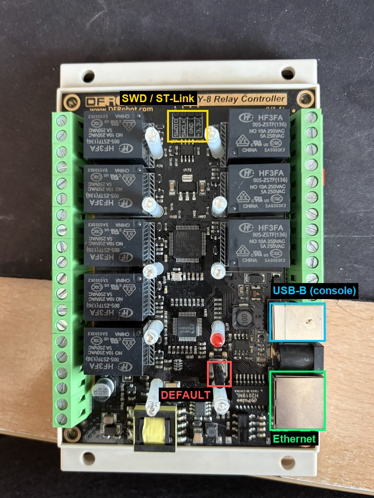
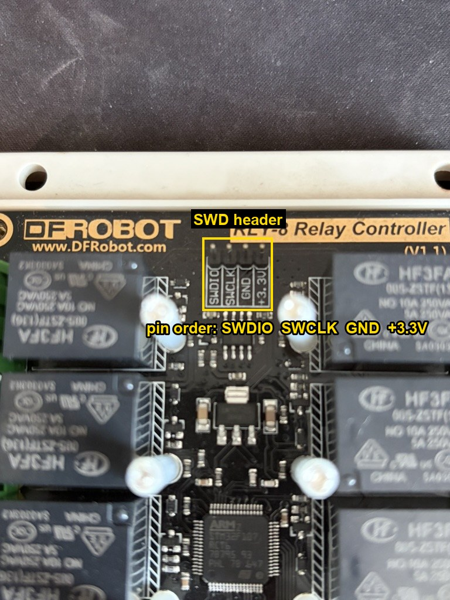

# RLY-8 open firmware — instrukcja użytkownika

Firmware zastępczy dla 8-kanałowego sterownika przekaźników **DFRobot RLY-8 (DFR0289)**.
Po wgraniu płytka działa jako urządzenie **MQTT dla Home Assistanta**. Ma **panel WWW**,
**konsolę USB** i **przycisk przywracania ustawień fabrycznych**.

> Projekt nie jest związany z firmą DFRobot. Wgranie firmware **zastępuje oryginalny**.
> Jeśli chcesz mieć możliwość powrotu, zrób najpierw kopię (pkt 2.2).
> Przekaźniki mogą przełączać napięcie sieciowe. Pracuj przy płytce odłączonej od sieci 230 V.



## 1. Co potrafi

- 8 przełączników w Home Assistant **bez konfiguracji ręcznej** (MQTT discovery)
- **autodetekcja brokera** w sieci (mDNS `_mqtt._tcp.local`, potem `homeassistant.local`)
- panel WWW: stan, przełączanie przekaźników, ustawienia sieci i MQTT, hasło, reset fabryczny
- konsola tekstowa po **USB** (gniazdo USB-B)
- nazwa w sieci lokalnej: `http://rly8-xxxxxx.local/`
- **przycisk DEFAULT** (5 s) przywraca ustawienia fabryczne
- **niebieska dioda** pokazuje stan urządzenia
- po włączeniu zasilania wszystkie przekaźniki są wyłączone

## 2. Wgranie firmware

### 2.1. Potrzebne

- programator **ST-Link** (wystarczy tani klon V2) i 4 przewody
- komputer z [pyOCD](https://pyocd.io) (`pip install pyocd`)
- plik `rly8-fw-vX.Y.Z.bin` z zakładki
  [Releases](https://github.com/lsochanowski/DFR0289-RLY-8-Firmware/releases)

### Podłączenie programatora

Złącze SWD jest u góry płytki, między przekaźnikami. Opis pinów jest na płytce:



| Pin na płytce | ST-Link |
| --- | --- |
| SWDIO | SWDIO |
| SWCLK | SWCLK |
| GND | GND |
| +3.3V | 3.3V — nie podłączaj, jeśli płytka jest zasilana z PoE/DC |

Płytkę zasil normalnie (PoE albo zasilacz DC).

### 2.2. Kopia oryginalnego firmware (zalecane)

```bash
pyocd cmd -t stm32f103rc -c "savemem 0x08000000 0x40000 rly8-oryginal.bin"
```

Jeśli odczyt zwraca błędy albo same zera, układ może mieć zabezpieczenie odczytu. Wtedy
kopii nie da się zrobić, a przed wgraniem trzeba wykonać `pyocd erase --chip`.

### 2.3. Wgranie

```bash
pyocd flash -t stm32f103rc rly8-fw-v1.0.0.bin --base-address 0x08000000
pyocd reset -t stm32f103rc
```

`stm32f103rc` to nie pomyłka. pyOCD nie ma wbudowanego profilu STM32F107, a algorytm
zapisu jest taki sam dla całej rodziny F1. Przy kilku programatorach dodaj `-u <UID>`
(lista: `pyocd list`).

## 3. Pierwsze uruchomienie

1. Podłącz kabel Ethernet. Płytka pobierze adres z DHCP.
2. Otwórz `http://rly8-xxxxxx.local/`. Adres możesz też sprawdzić w routerze albo w konsoli
   USB (`status`).
3. Zaloguj się: **admin / admin**. **Od razu zmień hasło** w zakładce *Ustawienia*.

Gdy w sieci nie ma serwera DHCP, po 15 s płytka ustawia adres **192.168.9.50/24**.

## 4. Home Assistant

1. W Home Assistant zainstaluj broker MQTT (np. dodatek **Mosquitto**) i integrację **MQTT**.
2. W panelu płytki (*Ustawienia → MQTT*) zostaw pole **Broker puste** (autodetekcja).
   Wpisz **użytkownika i hasło MQTT**, bo Mosquitto domyślnie nie wpuszcza anonimowych
   klientów.
3. *Zapisz i uruchom ponownie*. Po chwili w HA pojawi się urządzenie z 8 przełącznikami.

Stan połączenia widać w panelu (*Status → MQTT*) i na diodzie.

## 5. Panel WWW

- **Status** — link, adres IP, stan MQTT i adres brokera, 8 przycisków przekaźników,
  „Wszystkie ON/OFF”, restart.
- **Ustawienia** — DHCP lub adres statyczny (IP, maska, brama, DNS), nazwa hosta, MQTT
  (włącz/wyłącz, broker, port, użytkownik, hasło, prefiks discovery), nazwa urządzenia w HA,
  hasło panelu, przywrócenie ustawień fabrycznych.
- Puste pole hasła oznacza „bez zmian”. Zapis zapamiętuje ustawienia i restartuje płytkę.
- `http://<adres>/api/status` zwraca stan w JSON (np. do skryptów).

## 6. Konsola USB

Podłącz gniazdo USB-B do komputera. W systemie pojawi się port szeregowy:
- macOS: `/dev/cu.usbmodem*`
- Linux: `/dev/ttyACM*`
- Windows: port COM

Prędkość nie ma znaczenia.

```bash
screen /dev/cu.usbmodem* 115200
```

| Komenda | Działanie |
| --- | --- |
| `help` | lista komend |
| `status` | sieć, MQTT, przekaźniki |
| `show` | ustawienia (hasła ukryte) |
| `set <klucz> <wartość>` | zmiana ustawienia (do `save`) |
| `save` | zapis ustawień (działają po restarcie) |
| `reboot` | restart |
| `factory` | ustawienia fabryczne + restart |
| `relay <1-8\|all> <on\|off\|toggle>` | sterowanie przekaźnikami |

Klucze: `dhcp`, `ip`, `mask`, `gw`, `dns`, `hostname`, `name`, `mqtt`, `mqtt_host`,
`mqtt_port`, `mqtt_user`, `mqtt_pass`, `mqtt_prefix`, `admin_pass`.

Przykład — adres statyczny:

```text
set dhcp off
set ip 192.168.1.50
set mask 255.255.255.0
set gw 192.168.1.1
save
reboot
```

## 7. Przycisk DEFAULT i dioda

**Przytrzymaj DEFAULT przez 5 sekund**. Dioda zacznie szybko migać, potem zaświeci na stałe
i płytka uruchomi się z ustawieniami fabrycznymi: DHCP, hasło `admin`, MQTT z autodetekcją.

| Niebieska dioda | Znaczenie |
| --- | --- |
| krótki błysk co 2 s | brak kabla / linku Ethernet |
| miga 2× na sekundę | link jest, czeka na adres IP |
| podwójny błysk co sekundę | jest IP, brak połączenia z MQTT (np. złe hasło) |
| świeci, mrugnie przy akcji | wszystko działa |

## 8. Bezpieczeństwo

- Panel działa po **HTTP bez szyfrowania**. Używaj go w zaufanej sieci i zmień hasło domyślne.
- Hasła są zapisane w pamięci płytki **bez szyfrowania**.
- **Konsola USB nie ma hasła**. Kto ma fizyczny dostęp, może zmienić ustawienia, tak jak
  przyciskiem.

## 9. Ograniczenia

- Oryginalne protokoły DFRobot (JSON na porcie TCP 2000, ramki `55 AA` po RS485) nie są
  jeszcze obsługiwane.
- Stan przekaźników nie jest pamiętany po zaniku zasilania (start: wszystkie OFF).
